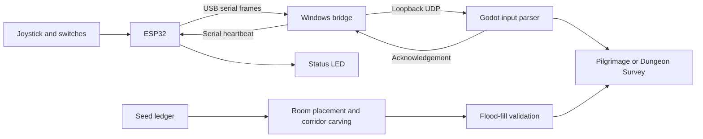

# Suvarna assessment and controller guide

**Pilgrimage** is the original side-scrolling game. **Dungeon Survey** is the top-down assessment mode. Both are available in the same animated title screen. A seed replays the same layout within its selected mode.

## Assessment floor

The Survey chooses six to eight non-overlapping rooms of varying dimensions on a 4-by-2 anchor grid. It grows from a random start slot through seeded neighboring connections, sometimes adds a loop, and carves two-tile-wide corridors. A flood fill ranks rooms by distance from the entrance. The farthest room holds the gate, and another reachable room holds the Dharma Key. The validator checks every floor tile, verifies that the key is reachable with the gate blocked, and rejects invalid spawn tiles. A player can explore, fight or bypass enemies, collect treasure, open the gate, and cross the threshold to complete the floor. Treasure, defeated enemies, and completion speed contribute to score.

| State | Entry and exit |
| --- | --- |
| Ledger | Choose a mode and roll, paste, or type the seed |
| Generating | Build the seeded floor and run the validator |
| Exploring | Move, discover tiles, fight or avoid enemies, and collect treasure |
| Key held | The key enables interaction with the gate |
| Gate unlocked | Walking onto the exit tile completes the Survey |
| Win / Game over | Result shows the score and seed. Retry the seed or roll a new one |

## Controller prototype

### Circuit and mapping

Use the **classic ESP32 DevKit** pinout for this starter design. Power the joystick from **3.3 V**, use a shared ground, and keep the USB cable accessible. Check GPIO 2 against the specific board's LED circuit, or use an external LED with a 220–330 ohm resistor. Use the board's USB connector for serial communication.

| Part | Connection | Game behavior |
| --- | --- | --- |
| Two-axis joystick | VRx to GPIO 34, VRy to GPIO 35, VCC to 3.3 V, GND to GND | Survey movement on both axes. Pilgrimage horizontal movement and up to jump. Left/right selects a mode at the ledger. |
| Interact button | GPIO 25 to GND on press | Use stairs, pick up keys or relics, and interact with exits |
| Slash button | GPIO 26 to GND on press | Swing the sword |
| Start button | GPIO 27 to GND on press | Start, skip the opening, open the map while playing, or retry after defeat |
| Reset button | GPIO 14 to GND on press | Generate a new seed |
| Status LED | GPIO 2 | Flashes while finding the game, steady while the game acknowledges packets |

The four switches use internal pull-ups. A secure prototype can use a breadboard or soldered perfboard, jumper wires, a USB data cable, and an enclosure around 220 × 120 × 65 mm. Record actual component prices and actual expenditure during construction.

### Connect on Windows

1. Flash `controller/SuvarnaController/SuvarnaController.ino` from Arduino IDE with the matching ESP32 board selected. Leave the joystick centered. Use the serial monitor at 115200 baud to confirm a changing `SV1,x,y,interact,slash,start,reset` line. Joystick values are 0–4095, with buttons as 0/1.
2. Close the serial monitor to release the port. Start Suvarna.
3. Run `powershell -File .\controller\Connect-SuvarnaController.ps1 -Port COM3` in the project folder, using the port shown for your board.
4. The bridge sends each valid serial line to the game over loopback UDP on port 24653. The game validates the data and replies `OK`. The bridge sends a heartbeat back to the ESP32, which lights the status LED.
5. Check movement in both modes, button edges, joystick centering, the LED, and safe recovery when the USB cable is unplugged. The game releases controller input after a timeout and keyboard play stays available.

## Testing and submission evidence

Use the on-screen seed to reproduce a reported problem. Record the seed, mode, steps, and expected result for each playtest. For an in-person demonstration, show seed replay, a different seed, key-first progression, a lost run, and physical controller disconnect and reconnect. Physical assembly, board testing, actual expenses, human playtest observations and the team's presentation and viva are completed during the course.

### Verified in the preview build

Godot checks passed for 500 Survey seeds and 200 Pilgrimage seeds. The recorded play-through covered both modes, the top-down key and exit, and the side-scrolling gate and retry. Controller packet validation passed. The test environment blocked the loopback socket, so end-to-end serial/UDP communication, firmware on a physical board, and the status LED still require a bench test. The approval clip is about one minute. The specification's separate 2–3 minute assessed demonstration remains a submission deliverable.
